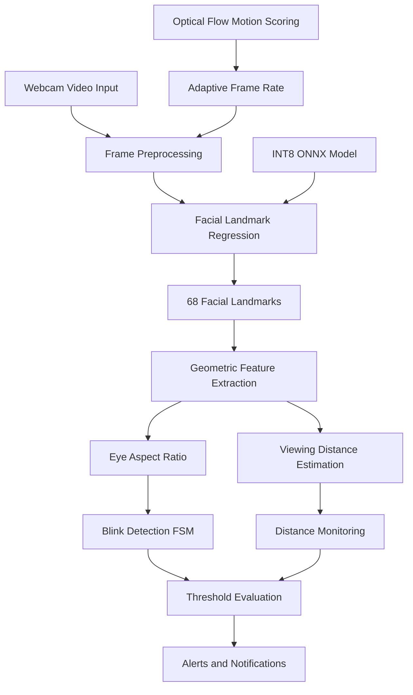

# 👁️ Real-Time Edge-Optimized Eye Health & Ergonomic Monitor

**A CPU-optimized computer vision application for real-time eye monitoring, blink analysis, and workstation ergonomics.**

<p align="center">
  
  
  
  
  
  
</p>

---

## 📌 Overview

The **Eye Health Monitor** is a real-time computer vision-based desktop application designed to monitor selected eye-related indicators and ergonomic habits during prolonged computer usage.

The system uses webcam-based facial analysis and deep learning-based facial landmark regression to estimate eye openness, detect blinking patterns, and calculate approximate viewing distance.

A major engineering focus is **edge optimisation**: the application explores model quantization, ONNX Runtime deployment, and adaptive frame-rate throttling to reduce computational overhead and support CPU-based inference.

The project combines computer vision, geometric feature extraction, deep learning deployment, and performance optimisation into a unified monitoring pipeline.

## ✨ Key Features

### 👁️ Eye Monitoring
- Real-time webcam-based facial analysis.
- 68-point facial landmark regression.
- Eye Aspect Ratio (EAR) calculation.
- Blink event detection using a Finite State Machine.
- Blink-frequency monitoring.
- Configurable low-blink-rate alerts.

### 📏 Ergonomic Monitoring
- Approximate viewing-distance estimation.
- Camera calibration using facial geometry.
- Head-yaw estimation to handle excessive head rotation.
- Configurable viewing-distance alerts.
- 20-20-20 eye-rest reminders.

### ⚡ Edge Optimisation
- PyTorch-to-ONNX model conversion.
- Static INT8 quantization.
- Custom calibration data reader.
- ONNX Runtime inference.
- Optical-flow-based motion scoring.
- Adaptive frame-rate throttling.

## 🏗️ System Architecture

The application follows a modular processing pipeline:



## 🧠 Technical Implementation

### 1. Facial Landmark Detection

The application uses a MobileNetV2-based facial landmark regression model.

- Framework: PyTorch
- Model architecture: MobileNetV2-based
- Landmark output: 68 facial landmarks
- Documented model input resolution: 192 × 192 pixels

The predicted landmarks provide geometric information required for eye analysis and viewing-distance estimation.

### 2. Eye Aspect Ratio (EAR)

EAR is used to estimate eye openness using six facial landmarks around each eye.

The mathematical formulation is:

\[
EAR = \frac{\|p_2-p_6\|+\|p_3-p_5\|}
{2\|p_1-p_4\|}
\]

A decrease in EAR indicates reduced eye openness and can be used to identify eye-closure events.

### 3. Finite State Machine-Based Blink Detection

A Finite State Machine identifies blink events through transitions between:

- Open-eye state
- Closed-eye state
- Open-eye recovery

This approach helps prevent repeated blink counting while the eye remains closed.

### 4. Viewing Distance Estimation

The system estimates viewing distance using facial geometry and camera calibration.

The pinhole camera relationship is:

\[
Z = \frac{fD}{d}
\]

Where:

- \(Z\): Estimated camera-to-user distance.
- \(f\): Calibrated focal length in pixels.
- \(D\): Assumed physical reference distance.
- \(d\): Measured pixel distance.

A documented reference interpupillary distance of 63 mm is used in the calibration procedure.

### 5. Static INT8 Quantization

The model is exported from PyTorch to ONNX format and optimised through static INT8 quantization.

The process involves:

1. Preparing the trained model.
2. Exporting the model to ONNX.
3. Preparing representative calibration samples.
4. Performing calibration.
5. Generating the quantized model.
6. Deploying the model through ONNX Runtime.

The objective is to reduce model storage requirements and improve CPU inference efficiency.

### 6. Adaptive Frame-Rate Throttling

Optical-flow-based motion scoring is used to estimate scene activity.

The application dynamically adjusts its processing frequency based on scene movement and user presence.

The documented processing range is:

- Maximum: 30 FPS
- Minimum: 2 FPS

This reduces unnecessary inference operations when scene activity is minimal.

## 🛠️ Technology Stack

| Technology | Purpose |
|---|---|
| Python | Core application development |
| OpenCV | Webcam acquisition and image processing |
| NumPy | Numerical computation |
| PyTorch | Deep learning model development |
| MobileNetV2 | Facial landmark regression architecture |
| ONNX | Model interoperability |
| ONNX Runtime | Model inference |
| Optical Flow | Motion estimation |
| INT8 Quantization | Model optimisation |

## 📂 Project Structure

```text
eye-health-monitor/
│
├── src/
│   ├── blink_fsm.py
│   ├── calibrate.py
│   ├── distance.py
│   ├── ear.py
│   ├── eye_monitor.py
│   ├── io_toasts.py
│   ├── monitor.py
│   └── utils.py
│
├── models/
│   └── [Model files]
│
├── assets/
│   └── [Application assets]
│
├── tests/
│
├── docs/
│
├── requirements.txt
├── .gitignore
└── README.md
```

*Note: Update the directory structure to match the actual repository contents.*

## ⚙️ Installation and Setup

### Prerequisites

- Python 3.x
- Git
- Webcam
- Windows, Linux, or another compatible desktop environment
- Sufficient RAM for model inference

### 1. Clone the Repository

```bash
git clone https://github.com/fairy224589-collab/eye-health-monitorr.git
```

### 2. Navigate to the Project Directory

```bash
cd eye-health-monitorr
```

### 3. Create a Virtual Environment

```bash
python -m venv venv
```

Activate it on Windows:

```powershell
.\venv\Scripts\Activate.ps1
```

### 4. Install Dependencies

```bash
pip install -r requirements.txt
```

### 5. Run the Application

Use the actual application entry-point file and command documented in the project.

For example:

```bash
python src/monitor.py
```

**Note:** Verify the entry point and required model files before running this command.

## 📊 Monitoring Parameters

The following values are documented in the current project configuration and should be verified against the deployed implementation.

| Parameter | Configured Value |
|---|---|
| Facial landmarks | 68 |
| Model architecture | MobileNetV2-based |
| Input resolution | 192 × 192 |
| Quantization | INT8 |
| Head-yaw tolerance | ±30° |
| Blink-rate alert | Below 8 blinks/minute |
| Viewing-distance alert | Below 45 cm |
| Maximum processing frequency | 30 FPS |
| Minimum processing frequency | 2 FPS |
| Break reminder | 20-20-20 rule |

## 📈 Performance Evaluation

The project focuses on evaluating model efficiency and runtime behaviour.

The following metrics are relevant to performance benchmarking:

- Model file size.
- Average inference latency.
- CPU utilisation.
- Memory consumption.
- Landmark prediction consistency.
- Processing frequency.

A comparative FP32-versus-INT8 benchmark should be conducted under consistent hardware and software conditions.

*Actual benchmark results will be added after measurement.*

## 🚧 Challenges and Engineering Considerations

Some important engineering challenges addressed by the project include:

- **Lighting Variations:** Frame luminance evaluation and dynamic gamma correction.
- **Landmark Stability:** Managing changes in facial orientation and image quality.
- **False Blink Detection:** FSM-based event detection and head-yaw estimation.
- **Distance Estimation:** Dependence on camera calibration and physical reference assumptions.
- **Inference Overhead:** Static INT8 quantization and ONNX Runtime deployment.
- **Resource Utilisation:** Optical-flow-based motion scoring and adaptive processing frequency.

## 🔮 Future Scope

Potential improvements include:

- Personalised camera calibration.
- Improved facial landmark robustness.
- More advanced head-pose estimation.
- User-specific blink monitoring thresholds.
- Expanded workstation ergonomics analysis.
- Cross-platform desktop support.
- More extensive FP32-versus-INT8 benchmarking.
- Improved inference scheduling and resource management.

## ⚠️ Disclaimer

This project is intended for general awareness of screen-use habits and workstation ergonomics.

It is not a medical device and does not diagnose, prevent, or treat eye-related medical conditions.

Viewing-distance estimates and blink measurements are approximate and depend on camera quality, calibration, lighting, and facial landmark accuracy.

## 📚 References

1. Sandler et al. (2018). *MobileNetV2: Inverted Residuals and Linear Bottlenecks*. CVPR.
2. Soukupová and Čech (2016). *Real-Time Eye Blink Detection using Facial Landmarks*.
3. [PyTorch Documentation](https://pytorch.org/docs/stable/)
4. [OpenCV Documentation](https://docs.opencv.org/)
5. [ONNX Documentation](https://onnx.ai/)
6. [ONNX Runtime Documentation](https://onnxruntime.ai/docs/)

## 🙏 Acknowledgement

This project builds upon an existing implementation used with permission.

Original implementation reference: [eye-health-monitor](https://github.com/nixx-04/eye-health-monitor).

Please refer to the original repository's licence and applicable attribution requirements. Subsequent modifications and independent development contributions should be documented separately.

---

<p align="center">
  **Built with Python, Computer Vision, and Edge AI.**
</p>
